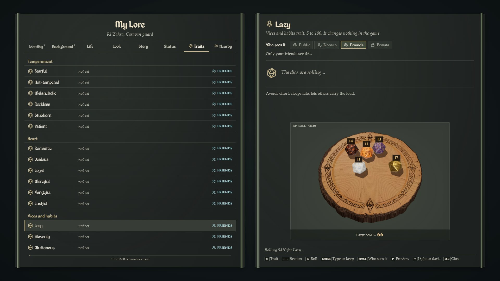
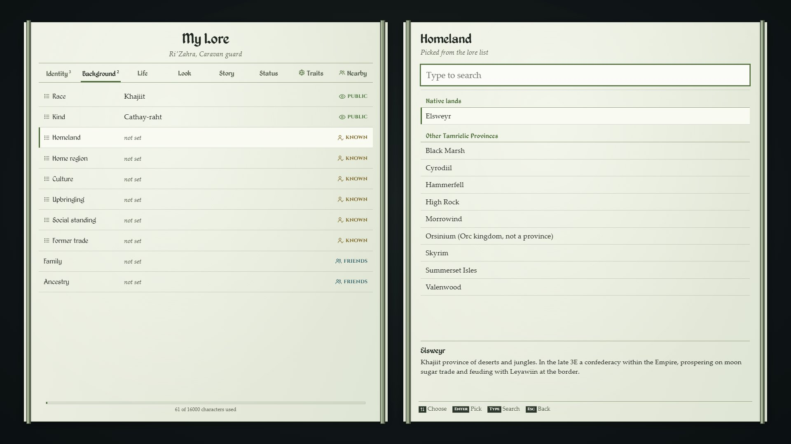
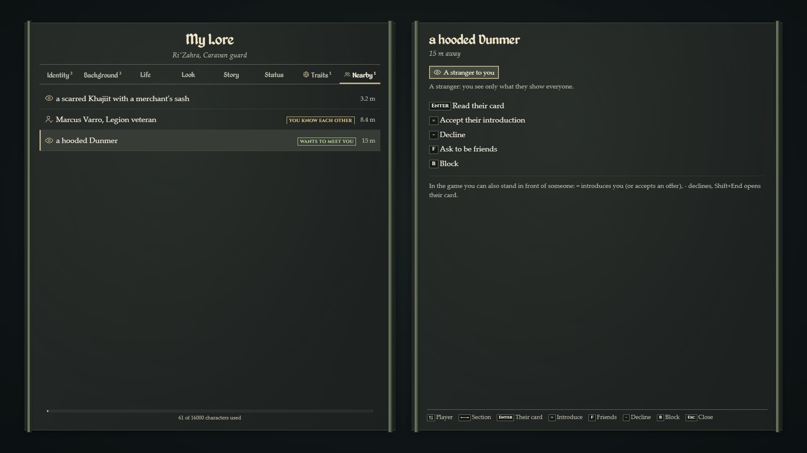

# MESOL (prototype)

> **Prototype.** This is an early, basic version, published so people can follow it and try it. Expect bugs, missing features and changes that break saved cards between versions. It has been tested in game by the author on a local server, mostly with one player.

**MESOL: My Elder Scrolls Oblivion Lore.** A lore-friendly character card for roleplay on [Oblivion Multiplayer (OB:MP)](https://docs.ready.mp/oblivion-mp/docs/what-is-oblivion-mp) servers by ReadyM. Each player fills in their character's card and decides who sees each part of it: everyone, the players they have met, their friends, or nobody. Other players read the card as its owner lets them.



*The card in the browser preview (see [Try the card in a browser](#try-the-card-in-a-browser)). In game it opens over the game with End.*

## What it is for

Roleplay servers need a way to say who your character is without breaking the scene: a name others only learn once you introduce yourself, a look anyone can see, a history only friends know. MESOL keeps that card on the server and shows each player only what the owner shared with them. It is inspired by roleplay profile add-ons from other games, written from scratch for The Elder Scrolls IV: Oblivion and the year 3E 433. It applies no game rules: nothing on the card changes skills, attributes or looks.

## Features

- **A card page** (End, or `/mylore`), keys only, in light or dark (V). The card has eight sections: Identity, Background, Life, Look, Story, Status, Traits and Nearby.
- **Lore you pick, words you write.**
  - **Picked from a lore list:** race, kind (for example Khajiit furstocks such as Cathay or Cathay-raht), homeland, home region, culture, upbringing, social standing, former trade, birthsign, class, faith, affiliation and rank. They can't be typed, so a card never claims a race that doesn't exist.
  - **Your own words:** names, looks and stories.
  - **The lore list:** 859 entries, each with a short summary.
- **Era rule:** everything fits the year 3E 433. Later factions are never offered, and older ones are offered only as family heritage.
- **Background:** your race's own province comes first, then the other provinces of Tamriel. The home region list only shows places inside the province you picked.
- **Who sees what, per field:** Public (everyone), Known (players you introduced yourself to), Friends, or Private (only you). The server cuts every card before sending it, so a player never receives a field they may not see.
- **Introductions as a handshake:**
  - Stand in front of someone and press `=`. They see a small offer at the top of the screen and accept with `=` (or decline with `-`).
  - Only when both agree do you see each other's names and the fields shared with people you know. Friendships work the same way.
  - Both can be taken back, and a player can be blocked.
- **Nearby:** the players within 20 m, as they let you see them. Open their card, introduce yourself, or ask to be friends from there. Shift+End opens the card of the player in front of you.
- **RP traits** (Fearful, Hot-tempered, Romantic, Lazy, Slovenly, Superstitious and 18 more): optional, from 5 to 100.
  - Type a value, and it stays for good.
  - Or press R to roll 5d20 with [RpRoll](https://github.com/pete-roman/obmp-rproll). The server rolls, the dice land on a small board in the card's tray, each die in a random dice set, and players within 20 m see the roll in chat. One reroll, then the value stays for good.
- **Chat commands** for everything, for players who prefer chat or when the page is not available.

| | |
|---|---|
|  |  |


## Controls

The full list is in [docs/CONTROLS.md](docs/CONTROLS.md). The short version:

| Key | What it does |
|---|---|
| End | open or close your card |
| Shift+End | the card of the player in front of you |
| = | introduce yourself to the player in front of you, or accept an offer |
| - | decline an offer |
| Up, Down / Left, Right | field / section |
| Enter | edit (in a long text: Enter is a new line, Ctrl+Enter saves) |
| Space | who sees the field |
| R | roll a trait (5d20), or the one reroll |
| P | preview your card as others see it |
| V | light or dark |
| Esc | back, or close |

Chat: `/mylore`, `/mylore card`, `/lore`, `/introduce`, `/friend add|accept|decline|remove|forget|block|unblock`. `/mylore help` lists the rest.

OB:MP 1.0 pages get no mouse, so the card is keys only, and the mouse pointer is hidden while the card is open. While the card is open the game gets no keys, so typing a name never moves your character.

## Requirements

- An OB:MP server, **1.0.0-rc.2**. MESOL is built against the public OB:MP SDK `1.0.0-rc.2` and the chat mod `1.0.0-rc.3` from NuGet.
- The chat mod that ships with the server (`OblivionMP.Chat`, 1.0.0 or newer).
- **[RpRoll](https://github.com/pete-roman/obmp-rproll) 0.8.5 or newer** on the same server. MESOL rolls traits through it, and the manifest makes it a dependency, so MESOL doesn't load without it.

## Install (server owners)

There is no prebuilt download yet. Build both mods from source (below), then:

1. Copy `obmp-rproll/bin/Release/mods/RpRoll/` and `obmp-mesol-prototype/bin/Release/mods/MESOL/` into your server's `mods/` folder.
2. Restart the server.
3. Players get the client parts from the launcher the next time they start the game and connect. Client mods load at game start, so reconnecting alone is not enough.

Check the server log for:

```
MESOL: lore catalog loaded, 859 entries ...
MESOL: /mylore registered, catalog mode "Canon".
MESOL: /introduce and /friend registered; = and - answer offers in game.
```

**Where the data lives.** Cards and relations are saved outside the mod folder, so replacing the mod with a new version never deletes them:

- `<server>/moddata/MESOL/cards/<ReadyM account id>.json`
- `<server>/moddata/MESOL/relations/<ReadyM account id>.json`

Every write keeps the previous file as `.bak`.

**Settings** (optional): `mods/MESOL/server/config.json`. An unknown key stops the mod from loading, so a typo is not silent.

```json
{
  "DataFolder": "",
  "CatalogMode": "canon",
  "AllowImplausibleSubtypes": false,
  "RaceLock": false,
  "LookRangeMeters": 5
}
```

- `DataFolder`: where cards and relations go. Empty means `<server>/moddata/MESOL`.
- `CatalogMode`:
  - `canon`: lore fields are picked only;
  - `canonPlus`: lore fields also take typed text, marked as custom;
  - `free`: free text everywhere.
- `AllowImplausibleSubtypes`: also offer kinds that don't fit the single Oblivion player model, such as Senche.
- `RaceLock`: when the game reports the character's race, the card's race must match it.
- `LookRangeMeters`: how far "the player in front of you" reaches.

**Your own lore.** Put JSON files in `<data folder>/catalog.d/` to add entries, replace entries with the same id, or hide entries. Use the same entry shape as `catalog/mesol-lore.json`:

```json
{ "entries": [ { "id": "settlement.my-town", "kind": "settlement", "name": "My Town", "parent": "region.heartlands",
                 "summary": "A town on our server.", "era": "current" } ],
  "hide": [ "faction.thalmor" ] }
```

## Building from source

You need the [.NET 10 SDK](https://dotnet.microsoft.com/download) and [Node.js](https://nodejs.org/) (developed with Node 24). MESOL builds against RpRoll's source, so clone both side by side:

```powershell
git clone https://github.com/pete-roman/obmp-rproll.git
git clone https://github.com/pete-roman/obmp-mesol-prototype.git

# RpRoll first (its board page shows MESOL's trait rolls)
cd obmp-rproll\web-src; npm install; node build.mjs; cd ..
dotnet build RpRoll.slnx -c Release
cd ..

# then MESOL
cd obmp-mesol-prototype\web-src; npm install; node build.mjs; cd ..
dotnet build MESOL.slnx -c Release
```

The ready-to-copy mod folders are `obmp-rproll/bin/Release/mods/RpRoll/` and `obmp-mesol-prototype/bin/Release/mods/MESOL/`. To build against RpRoll somewhere else, pass `/p:RpRollRoot=<folder>\` to `dotnet build`. To target another OB:MP version, change `ObmpSdkVersion` and `ObmpChatVersion` in `Directory.Build.props` (in both mods).

## Tests

```powershell
dotnet test MESOL.slnx -c Release     # 86 unit tests: card rules, catalog, privacy, traits, introductions, friends, chat commands

cd web-src
node test/browser.mjs                 # the built page in headless Chrome, played with the player's keys
node test/browser.mjs --size 2560x1600 --shots <folder>
```

`browser.mjs` needs Google Chrome. It looks in the default Windows location; set `CHROME_PATH` to use another one.

These are automated tests outside the game. They don't replace a test on a server with real players.

## Try the card in a browser

After `node build.mjs`, open `web-src/preview/index.html` in a normal browser. The preview runs the same page against a stand-in server with the real lore list:

- the buttons at the bottom open the card, show another player's card, and make a nearby player offer an introduction;
- Nearby has three stand-in players;
- End opens and closes the card, as in game.

## Status

**Tested in game by the author** (local OB:MP 1.0.0-rc.2 server, one client):
- the card page, light and dark;
- lore pickers, free-text fields and who-sees-it;
- trait rolls on RpRoll's small board;
- the End, Shift+End and = keys and the offer messages.

**Not tested in game yet:**
- introductions, friendships and blocks between two real players;
- typing accented letters into the card;
- whether a mouse click can still take the keyboard from the card (it should be given back at once).

**Known limits**

- RP names over players' heads are not done yet. Players still see the names the server shows today.
- No staff tools yet: no admin view of cards and no reports.
- Offers live 30 seconds and are not kept over a server restart. Introductions and friendships are kept.
- The client part is about 280 KB, downloaded by every player who joins the server.

**Planned**

- Names over heads that follow what each player shares.
- Staff tools: view a card for moderation, and a log of what staff looked at.

## Project layout

| Path | What |
|---|---|
| `Server/` | cards and their rules (`Cards/`), the lore list (`Catalog/`), introductions and friends (`Relations/`), the page's requests (`Page/`), chat commands (`Commands/`), saving (`Storage/`) |
| `Client/` | the card page and the offer panel in game, their keys, the link to the server |
| `Common/` | the RPC contract shared by both sides, and the message chunking |
| `Tests/` | unit tests (xUnit), never packed into the mod |
| `web-src/` | the card page and the offer panel: `src/`, `assets/fonts/`, `test/`, and a browser preview with a stand-in server |
| `catalog/` | the lore list, `mesol-lore.json` |
| `docs/` | the controls, and the screenshots for this README |
| `manifest.json` | the mod's id, version and dependencies |

## Credits and licence

Made by Piotr 'Pete' Romanczyk in collaboration with ReadyM, as part of the OB:MP project. Built with AI coding assistants (Claude Code and OpenAI Codex).

MESOL is licensed under the [MIT License](LICENSE). Third-party parts keep their own licences, listed in [THIRD-PARTY-NOTICES.md](THIRD-PARTY-NOTICES.md):

- Cinzel by The Cinzel Project Authors (SIL Open Font License 1.1).
- Kingthings Petrock and Petrock Light by Kevin King, shipped unchanged with his EULA.

The lore summaries in `catalog/mesol-lore.json` are original text, written from research on the [Unofficial Elder Scrolls Pages](https://en.uesp.net/) (UESP); each entry links its sources.

MESOL is not affiliated with Bethesda Softworks or ZeniMax. The Elder Scrolls and Oblivion are trademarks of ZeniMax Media Inc.; the names of races, places and factions come from the games. No game files or game assets are included.
